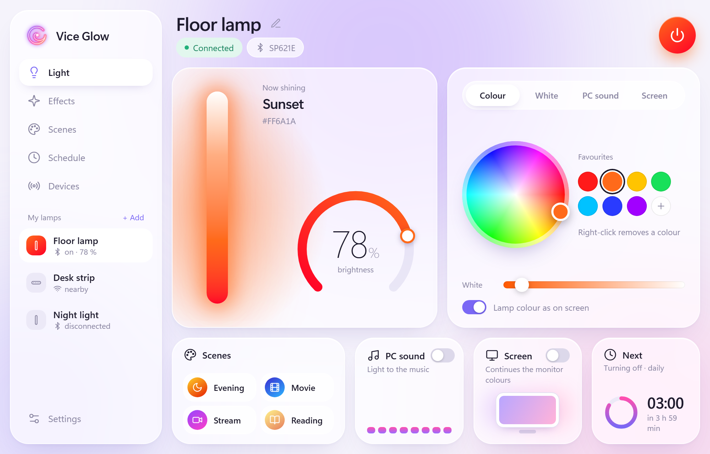
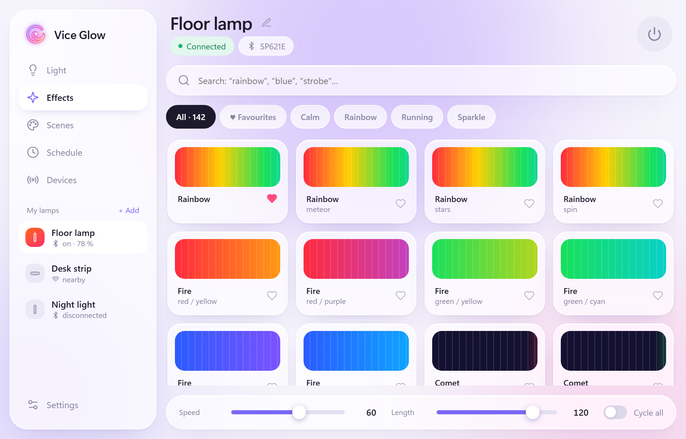
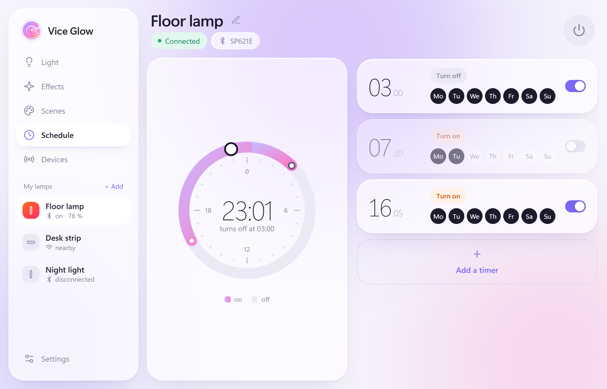
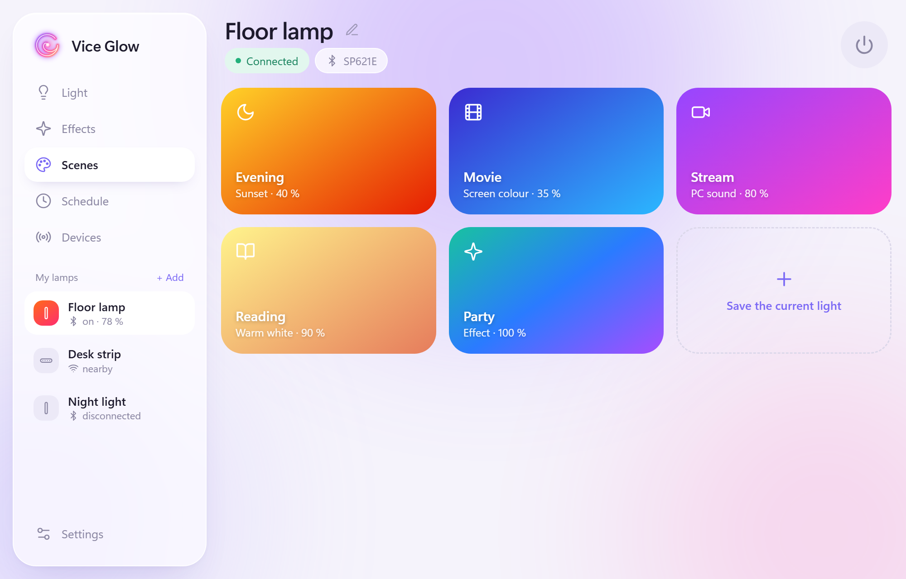
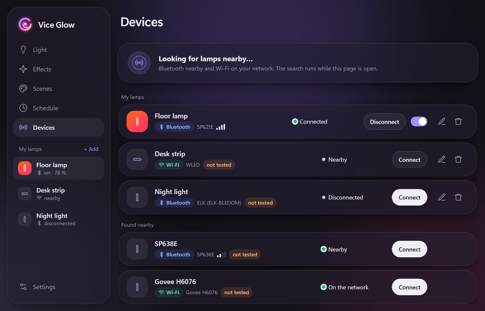

# Vice Glow

Control your LED lamps from the Windows tray: colour, brightness, effects, scenes, schedules,
light that follows the music your PC plays or the colours on your screen. Bluetooth and Wi-Fi
lamps of many brands, no phone needed.



## Features

- **Colour and brightness** — a vivid colour wheel, favourite colours, a brightness arc (drag it
  or turn the mouse wheel). *Lamp colour as on screen* corrects the colour for LEDs, so the lamp
  shows what you picked; the white balance of each lamp can be tuned.
- **Effects** — the lamp's built-in effects with live previews, search, groups (calm, rainbow,
  running, sparkle) and favourites. Speed, length and cycling where the lamp supports them.
- **Scenes** — save the current light and restore it in one click, from the window or the tray.
- **PC sound** — the lamp pulses to whatever your PC plays (not the microphone), in your colour
  or as a rainbow to the beat.
- **Screen colour** — the lamp continues the colours of your monitor, like ambient TV lighting.
- **Schedule** — on / off timers stored in the lamp itself (they work with the PC off), shown on
  a 24-hour dial; if the lamp loses power and forgets them, Vice Glow writes them back. BanlanX
  SP611E–SP621E for now.
- **Devices** — lamps nearby are found automatically (Bluetooth and your Wi-Fi network) and
  recognised by model before connecting. Connection is separate from the lamp's power.
  Rename a lamp — BanlanX SP611E–SP621E take the new name themselves.
- **Tray and hotkeys** — on / off, brightness, favourite colours, scenes and switching lamps from
  the tray menu; `Ctrl+Alt+L` toggles the lamp, `Ctrl+Alt+PgUp` / `PgDn` change brightness —
  any combination can be set in Settings.
- The window opens next to the tray and can be pinned to stay open.
- Light and dark themes; English, German, French, Spanish, Portuguese, Polish, Italian, Turkish
  and Ukrainian.

| | |
|---|---|
|  |  |
|  |  |

## Supported lamps

Protocols come from open-source projects (see [Credits](#credits)). Only **BanlanX SP621E** is
tested on a real lamp so far; everything else is marked *not tested* in the app. If your lamp
works (or doesn't), please open an issue.

### Bluetooth

| Family | Models / advertised names | Phone app it replaces | Reads the lamp's state |
|---|---|---|---|
| BanlanX | SP611E, SP617E, SP620E, **SP621E** ✔ | BanlanX | yes |
| BanlanX | SP613E, SP614E, SP623E, SP624E | BanlanX | yes |
| BanlanX | SP630E–SP63CE, SP641E–SP64CE, SP648E | BanlanX | yes |
| BanlanX | SP601E, SP602E, SP608E | BanlanX | no |
| SP LED | SP110E, SP107E | LED Hue, LED Chord | yes |
| ELK-BLEDOM | ELK-BLEDOM, ELK-BLEDOB, ELK-BLEDDM, ELK-BULB, ELK-LAMPL, MELK, JACKYLED, XROCKER, LED-… | duoCo Strip, Lotus Lantern, Lotus Lamp X | no |
| Triones | LEDnet, BLE-LED, LEDBLE, Triones, LEDBlue, Dream~, QHM-, AP- | HappyLighting | yes |
| Zengge | LEDnetWF, IOTB | Zengge, Magic Hue | yes |
| Keepsmile | KS03~ | Keepsmile | no |
| Govee | Govee_…, ihoment_…, GBK_… (H6xxx) | Govee Home | no |
| iDeal LED | ISP-…, IDL-… | iDeal LED | no |
| LED Lamp | LEDBLE-01… | LED LAMP | no |
| MohuanLED | BJ_LED | MohuanLED | no |

Lamps that only say "LED" or "lamp" in their name are listed as *unknown protocol*.

### Wi-Fi (local network, no cloud)

| Family | Notes | Reads the lamp's state |
|---|---|---|
| Magic Home / Zengge Wi-Fi | | yes |
| BanlanX SP530E, SP538E / SP548E, SP539E / SP549E | | yes |
| WLED | effects are read from the device | yes |
| Govee | turn on *LAN Control* in the Govee app | no |
| Yeelight | turn on *LAN Control* in the Yeelight app | yes |
| WiZ | | yes |
| LIFX | | yes |
| Nanoleaf | pairing: hold the power button 5–7 s, then *Connect* | yes |
| Philips Hue | through the bridge; press its button, then *Connect* | yes |

Not supported: Tuya / Smart Life (needs keys from their cloud) and lamps with closed protocols.

### Good to know

- Most Bluetooth lamps accept **one connection at a time**. Vice Glow lets the lamp go 20 s after
  you stop using it (unless the window is open or a live mode runs), so the phone app can
  reach it again; close the phone app while using Vice Glow.
- Want your lamp supported? Turn on *Bluetooth HCI snoop log* in Android developer options,
  control the lamp from its app, take a bug report and open an issue with it — the commands are
  in the log. That is how the BanlanX timers and renaming were added.

## Install

1. Download `ViceGlow.exe` from [Releases](https://github.com/Fenderenko/ViceGlow/releases).
2. Run it. Settings live in `%APPDATA%\Vice Glow`.

Needs Windows 10 / 11 with Bluetooth LE (for Bluetooth lamps) and the WebView2 Runtime (built
into Windows 11).

## Build

Rust (stable, edition 2024) with the MSVC toolchain:

```
cargo build --release
```

The exe is `target\release\viceglow.exe`. `tools/gen_fx.py` regenerates the effect tables
(`web/fx.json`) from UniLED's sources.

## Credits

Lamp protocols were learned from these projects:
[UniLED](https://github.com/monty68/uniled) (BanlanX),
[led-ble](https://github.com/Bluetooth-Devices/led-ble) and [flux_led](https://github.com/Danielhiversen/flux_led) (Triones, Magic Home),
[elkbledom](https://github.com/dave-code-ruiz/elkbledom) and [LotusLantern](https://github.com/Rxflex/LotusLantern) (ELK-BLEDOM),
[lednetwf_ble](https://github.com/8none1/lednetwf_ble) (Zengge),
[idealLED](https://github.com/8none1/idealLED), [bj_led](https://github.com/8none1/bj_led), [ledble-ledlamp](https://github.com/8none1/ledble-ledlamp),
[curl_smile](https://docs.rs/curl_smile) (Keepsmile),
[govee_ble_lights](https://github.com/Beshelmek/govee_ble_lights) and [govee_btled](https://github.com/chvolkmann/govee_btled) (Govee),
and the public LAN APIs of WLED, Govee, Yeelight, WiZ, LIFX, Nanoleaf and Philips Hue.

## License

[GPL-3.0](LICENSE) © Fenderenko

---

## Українською

Vice Glow — програма в треї Windows для світлодіодних ламп: колір, яскравість, ефекти, сцени,
розклад, світло за звуком комп’ютера й кольором екрана. Лампи через Bluetooth і Wi-Fi різних
виробників (див. таблиці вище), без телефона. Мову інтерфейсу можна змінити в налаштуваннях.
Наживо перевірено лише BanlanX SP621E — напишіть, якщо ваша лампа працює чи ні.
